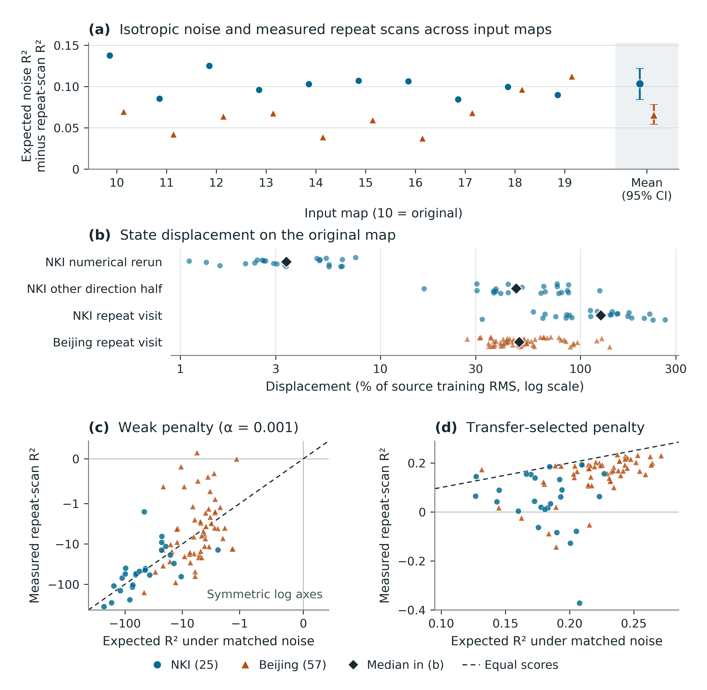

# Size-matched isotropic noise overestimates decoder portability across repeat structural connectomes

Can noise added to a simulated brain network predict how well a trained decoder will work when the same person is scanned again? This benchmark drives a person's first and repeat structural connectomes with the same simulated input. A linear decoder trained on the first graph recovers past inputs from the regional states. Its weights stay fixed when it is tested on the repeat graph and when its expected recall is calculated under matched noise on the first graph.

[Run the synthetic example](#run-the-synthetic-example) · [Use your own scans](benchmark/README.md) · [Paper figures and tables](results/README.md) · [Analysis scripts](scripts/README.md) · [Reproduce the study](docs/REPRODUCIBILITY.md)

## What the repeat scans showed

The study used 25 participants from the Nathan Kline Institute–Rockland Sample (NKI) and 57 from Beijing Normal University (Beijing). On each of ten input maps, isotropic noise matched to the size of the measured state change overestimated mean repeat-scan recall in both cohorts.

| Cohort | First-scan R² | Expected R² under matched noise | Measured repeat R² | Mean overestimate (95% interval) |
| --- | ---: | ---: | ---: | ---: |
| NKI | 0.192 | 0.185 | 0.082 | 0.103 (0.084 to 0.122) |
| Beijing | 0.201 | 0.192 | 0.127 | 0.065 (0.054 to 0.078) |

Recall is the mean held-out R² across ten input delays. For each participant and map, the ridge penalty was chosen using other participants. The table averages the ten maps within each participant. Intervals resample participants and retain the pairing between the two test conditions. [Participant scores](results/headline-robustness/people.csv) · [Map and cohort estimates](results/headline-robustness/map_portability.csv) · [Figure 1 as a PDF](results/portability-path/Figure_1.pdf)



### Sensitivity checks

- **Regional noise.** Matching the noise level in each region separately reduced the ten-map mean overestimate to 0.078 R² in NKI and 0.032 in Beijing. On one Beijing map this control underestimated repeat-scan recall. [Results](results/regional-noise/README.md) · [Analysis script](scripts/regional_noise.py)
- **Beijing parcellation.** On one Schaefer-200 input map in the same 57 Beijing participants, isotropic noise overestimated mean repeat-scan R² by 0.072 (95% interval 0.046 to 0.102). [Results](results/schaefer200-repeat/README.md) · [Analysis script](scripts/schaefer200_repeat.py)
- **NKI visit labels.** Excluding the participant whose second-visit code could not be matched left 24 participants. The ten-map isotropic overestimate was 0.106 R² (95% interval 0.086 to 0.124), compared with 0.103 for all 25. [Results](results/nki-visit-sensitivity/README.md) · [Analysis script](scripts/nki_visit_sensitivity.py)

## Run the synthetic example

From the repository root with Python 3.10.19, run the following commands. The example generates two scans each for five fictional participants.

```sh
python -m pip install -r requirements-benchmark.txt
python -m benchmark.example demo.npz
python -m benchmark demo.npz demo-results --penalties 0.01 1 10 --state-comparisons
```

Open `demo-results/state_summary.csv` for the cohort comparison and `demo-results/state_pairs.csv` for each participant’s source, noise and repeat scores. To run the same comparison on your own scans, supply aligned connectivity matrices, participant IDs and visit labels in a NumPy archive. [Input format and output columns](benchmark/README.md)

## Data and reproduction

- The results index links each paper figure and table to its underlying files. [Study results](results/README.md)
- The data guide identifies the NKI and Beijing matrices and the checksums used to verify them. [Source data](docs/DATA.md)
- The reproduction guide gives the full replay commands for downloaded or locally stored inputs. [Reproduction guide](docs/REPRODUCIBILITY.md)
- The protocols document the designs and analysis choices for individual comparisons. [Study protocols](protocols/README.md)

## Citation and licenses

Bayazit Karaman, *Readout transfer across repeat structural connectomes*, benchmark version 0.2.1. Please also cite the datasets you use. [Software citation](CITATION.cff) · [Data and software sources](benchmark/SOURCES.md)

Original code and documentation are licensed under MIT. Original derived tables and figures are licensed under CC BY 4.0. The bundled conn2res code retains its BSD 3-Clause license. [MIT](LICENSE) · [CC BY 4.0](LICENSE-data.txt) · [conn2res license](vendor/LICENSE)
