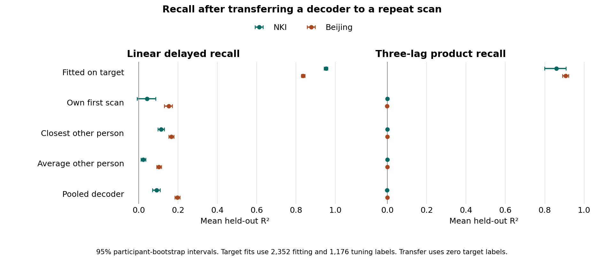

# When does a frozen connectome decoder transfer?

Each of 25 NKI and 57 Beijing participants contributed two measured wiring matrices. A simulated random signal drove a reservoir on each matrix. At a relative ridge penalty of 0.001, linear readouts scored a mean expected R² of 0.573 in NKI and 0.416 in Beijing under 1% source-state noise. Repeat scans moved the readout states by 132.3% and 56.9% of source-state RMS on average. Isotropic noise matched to each repeat’s size also drove expected R² below zero at that penalty. At the transfer-selected penalties, actual repeat scans still produced lower mean recall than matched isotropic noise in both cohorts. Choosing another person’s decoder by wiring similarity improved recall over selecting a typical donor. Edge weighting and parcellation changed that benefit. [Matched accuracy and portability results](../portability-path/README.md)

The high source scores reflect performance on fresh inputs with the wiring held exactly fixed. Adding a small amount of observation noise exposed the sensitivity of the weakest-penalty readouts. The [noise experiment](../portability-path/noise_source_paths.pdf) and [participant medians and positive-score fractions](../portability-path/robust_participant_paths.pdf) describe where stable prediction was observed.

## Two tasks, the same 82 people

| Mean held-out R² | NKI linear | NKI three-lag product | Beijing linear | Beijing three-lag product |
|---|---:|---:|---:|---:|
| Fitted on the target | 0.9521 | 0.8592 | 0.8362 | 0.9062 |
| Own first-scan decoder | 0.0428 | −0.00097 | 0.1526 | −0.00126 |
| Average of other individual decoders | 0.0238 | −0.00098 | 0.1035 | −0.00103 |
| Closest other person by wiring | 0.1141 | −0.00102 | 0.1667 | −0.00113 |
| Pooled decoder | 0.0908 | −0.00124 | 0.1971 | −0.00118 |

The nonlinear comparison was specified before scoring. Its scalar target was u(t−1) × u(t−2) × u(t−3). Both tasks used an identical map of eight input regions, the same simulated input streams and a common training budget. The pooled decoder divided its 2,352 fitting steps among the other people. Each local reference used 2,352 fitting steps and 1,176 separate validation steps from its own target graph. Frozen arms used zero target training or validation labels. Four fresh 512-step streams supplied evaluation labels. All intervals below are paired 95% participant bootstraps conditional on the observed donor bank, tuning procedure and test signals.

The first row describes what each target network can learn locally. It uses a separately fitted decoder and its own validation labels. For a wiring-substitution estimate, compare the source and target scores of **one frozen decoder at the same penalty** in the linked paths.

The closest-minus-average donor gain was +0.0904 [0.0680, 0.1129] in NKI and +0.0633 [0.0484, 0.0788] in Beijing for linear recall. On the product task it was −0.000035 [−0.000516, 0.000374] and −0.000102 [−0.000512, 0.000244], respectively. On the linear task alone, the closest donor exceeded the pool by 0.0233 [−0.0003, 0.0479] in NKI and fell below it by 0.0304 [0.0210, 0.0405] in Beijing. The previously specified calibration threshold tied in both cohorts.

The product could be learned locally by every participant's network. Tuning on other people's transfer results selected strong regularization and produced almost constant predictions even on the original source graph. In a follow-up grid that included the exact source-mean predictor, validation chose the constant predictor for all 600 NKI pairs. In Beijing the wider grid still produced near-zero transfer. A separate simulation and ridge solver verified all 3,792 primary single-donor penalty choices and 240 selected own/other score pairs. The maximum checked R² discrepancy was below 1.5 × 10⁻¹¹. [Nonlinear protocol and diagnostics](../nonlinear-recall/README.md) · [Verification](../nonlinear-recall/independent_verification.json) · [Paired scores](task_comparison_people.csv) · [Intervals](task_comparison_summary.csv)

## Which pipeline choices matter?

We varied one factor at a time on the linear task. With the native cross-visit penalty held fixed, anatomical donor selection retained a positive mean gain with binary edges, fixed edge count, and radii of 0.70 and 1.00 in both cohorts. Large apparent gains under weak ridge sometimes arose because the average donor performed poorly. Absolute performance should accompany the gain. Beijing's log-transformed weights and both Schaefer resolutions were particularly sensitive to reusing a ridge value from another graph representation.

A secondary comparison retuned ridge on the remaining 55 people for every Beijing pair. The same people and visits had complete data at both Schaefer scales, and eight input sites were matched across scales by hemisphere and physical location. The sampled Schaefer parcels cover cortex, while native DKT includes subcortical regions. Only the Schaefer 200-versus-300 comparison tests within-family resolution. Changing resolution changes the number of available readout regions.

| Beijing representation after retuning | Closest donor R² | Closest minus average donor [95% interval] |
|---|---:|---:|
| Original weighted DKT | 0.167 | +0.063 [0.048, 0.079] |
| DKT, log-transformed weights | 0.072 | −0.007 [−0.039, 0.020] |
| Schaefer 200 | 0.008 | −0.029 [−0.115, 0.028] |
| Schaefer 300 | 0.075 | +0.020 [0.012, 0.028] |

The direct paired difference in matching gains between 300 and 200 parcels was +0.049 [−0.009, 0.137]. A general increase in matching benefit with resolution remains uncertain. All 228 additional public m2g scan files were checked against the source object checksums. We used matched Beijing scans because the multi-scale Lausanne individual release lacks this repeat-scan comparison. [Design](PROTOCOL.md) · [All fixed settings](summary.csv) · [Retuned comparisons](retuned_summary.csv) · [Similarity curves](similarity_curves.csv) · [m2g source](https://docs.neurodata.io/m2g/paper/data.html)

## Numerical perturbation and fitted-score repeatability

Across the four NKI visit/half conditions, a fixed linear decoder averaged R² of 0.18876 on the original graph, 0.18823 on a numerical rerun, 0.16389 on the other diffusion half, and 0.06092 on the other visit. All 2,000 numerical runs came from the original 25 people. Of these, 986 reproduced all off-diagonal weights exactly. The mean original-to-rerun loss was 0.00053 [−0.00001, 0.00107] across all runs, and 0.00092 [−0.00026, 0.00202] when only changed graphs were considered. These values apply to the released input perturbation and fixed linear decoder. Acquisition, registration and anatomical changes remain inseparable across visits. The source study already assessed numerical perturbations of connectomes; our comparison measures their downstream effect on a frozen readout. [Perturbation protocol, source and results](../numerical-repeat/README.md)

Separately training a decoder on each visit gave high average local scores on both tasks. Absolute-agreement single-measure ICCs across visits were 0.430 (NKI) and 0.318 (Beijing) for linear recall, and 0.032 and 0.204 for product recall. Intervals were wide. These are secondary measurements of a simulated outcome. [Reliability estimates and intervals](fitted_score_reliability.csv)

## Using the benchmark on a new dataset

Report the task, atlas, edge transformation, input/readout mapping, radius, and rule for selecting ridge. Evaluate the same weights on the original and repeat matrices with identical fresh inputs. Include a target-local reference and the pooled alternative when available. Select similarity measures and intended minimum useful R² before checking held-out outcomes, and estimate performance in the actual target population. Give the numbers of unique people as well as pairs in each similarity bin.

For example, 223 Beijing stranger pairs across 41 targets had native wiring correlations from 0.85 to 0.92. At an illustrative held-out R² of 0.10, **207/223** of these pairs reached that value for linear recall and **0/223** for the product task. Their respective mean R² scores were 0.167 and −0.0011. Similarity alone cannot furnish a task-independent deployment cutoff. [Task-specific operating points](task_similarity_curves.csv)
