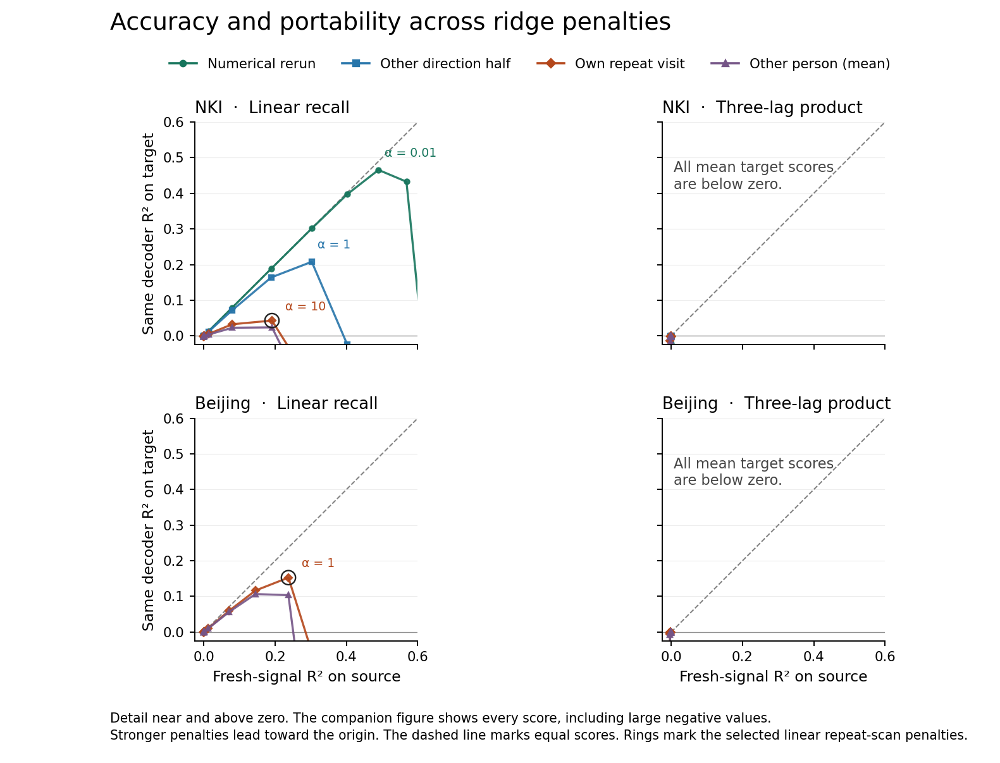

# Accuracy and portability of a frozen connectome decoder

In connectome-based reservoirs driven by identical simulated inputs, replacing a person’s first structural scan with their repeat scan displaced readout states by 132.3% of source training RMS in NKI and 56.9% in Beijing. A numerical rerun of the NKI first scan displaced the states by 3.9%, and using the other half of its diffusion directions displaced them by 57.7%. For linear recall, independent isotropic noise matched to the size of each repeat-scan displacement overestimated how well a frozen decoder would transfer at the penalty selected for transfer. From source R² of 0.191 in NKI and 0.237 in Beijing, matched noise left expected R² of 0.181 and 0.222. The repeat scans gave 0.043 and 0.153. The additional losses were 0.138 [paired 95% interval 0.092, 0.192] and 0.069 [0.053, 0.088]. [Matched-noise results](shift_summary.csv) · [Trajectory summaries](trajectory_summary.csv)

At a weaker ridge penalty (α = 0.001), repeat-sized isotropic noise drove expected linear recall R² below zero for every participant. The measured repeat scan gave positive R² for 0 of 25 NKI participants and 1 of 57 Beijing participants. Displacement magnitude was sufficient for widespread failure at this penalty, and the two perturbations produced different mean losses. For three-lag product recall, the best mean fixed-graph R² under 0.1% state noise was 0.063 in NKI and 0.139 in Beijing. Mean numerical-rerun scores in NKI were below zero throughout the penalty path. These product results leave the specific contribution of between-visit wiring changes unresolved.



Each point gives two evaluations of the same decoder at one relative ridge penalty (α). Both graphs received identical fresh signals. The dashed line marks equal source and target R². Rings indicate the original linear transfer penalties, selected using other participants' validation outcomes. The numerical and split-half labels identify descriptive points on the curves. The curves connect discrete measurements. [Full range, including negative R²](accuracy_portability_full.png) · [Vector figures for print, detail](accuracy_portability_detail.pdf) and [full range](accuracy_portability_full.pdf) · [All estimates, participant medians and 95% intervals](path_summary.csv)

## Fixed-graph perturbations and repeat scans

At α = 0.001, the source readout and penalty were held fixed across the following comparisons. Noise was added to the states at test time on the source graph. A 1% noise level means the noise standard deviation was 1% of the source’s root-mean-square state fluctuation during training. Relative to the source-noise and repeat tests, the NKI numerical comparison used separate fresh input streams keyed to visit one.

| Linear recall at α = 0.001 | NKI, 25 people | Beijing, 57 people |
|---|---:|---:|
| Mean expected source R² under 1% state noise | 0.573 | 0.416 |
| People with positive expected source R² under that noise | 25/25 | 57/57 |
| People with positive mean R² over 20 numerical reruns of their first-scan source | 23/25 | Unavailable |
| People with positive R² on their repeat visit | 0/25 | 1/57 |

Restricting the numerical analysis to the first visit’s odd-direction source uses the same trained NKI readouts as the repeat comparison. The 23/25 count averages the 20 reruns separately for each participant. The four-source average in the participant figure includes both visits and both direction halves and is positive in 25/25. Across all four source conditions, the highest observed mean linear target R² was 0.466 for numerical reruns at α = 0.01 and 0.208 for the opposite direction half at α = 1. The comparison at α = 0.001 illustrates the limits of using either perturbation test alone to establish portability. [Per-person state-noise scores](noise_people.csv.gz) · [Technical scores by visit and direction half](rung_pairs.csv.gz) · [Repeat-scan scores](visit_people.csv.gz)

## How large was the state change?

We drove each source and replacement graph with identical fresh signals and computed the root mean square (RMS) of the difference in readout states over all scored times and readout regions. The denominator was the square root of the mean coordinate variance in the **source training states**, the same unit used for the 1% noise experiment. A change above 100% means the displacement exceeded that typical source-state fluctuation. We matched each replacement separately before averaging over reruns and participants.

| First-visit source, linear recall at α = 0.001 | Mean state change, % of source RMS | Mean R² with size-matched isotropic noise | Mean R² on replacement | Participants positive on replacement |
|---|---:|---:|---:|---:|
| NKI numerical rerun | 3.9% | 0.445 | 0.385 | 23/25 |
| NKI opposite direction half | 57.7% | −12.74 | −23.46 | 0/25 |
| NKI repeat visit | 132.3% | −68.31 | −80.37 | 0/25 |
| Beijing repeat visit | 56.9% | −7.76 | −14.67 | 1/57 |

The NKI technical rows use the same 25 first-visit odd-direction source decoders as the forward visit comparison. Technical pairs use fresh streams keyed to visit one, and visit pairs use fresh streams keyed to visit two. The mean state change restricted to first-visit numerical reruns with altered edges was 8.0%. Using all four NKI source visit/half positions, the all-rerun, changed-only and opposite-half means were 3.4%, 6.9% and 48.6%, respectively. For the visit comparisons the median participant displacement was 126.3% in NKI and 49.4% in Beijing.

We compared each measured graph substitution with independent zero-mean observation noise added after the recurrence, with the same expected squared state displacement. For a frozen linear output with weight vector *w*, the expected increase in test MSE is the squared displacement RMS times ‖*w*‖². We used this exact expectation for the tables. Gaussian injections at the observed displacement scale on four repeat pairs reproduced the expected increase to within 0.9%. At α = 0.001 the measured repeat gave mean R² 12.06 below matched noise in NKI [paired 95% interval −7.76, 34.92] and 6.91 below matched noise in Beijing [2.04, 13.08]. The NKI interval allows either ordering, and the interval in Beijing favors matched noise.

At the transfer-selected penalty, expected R² under matched isotropic noise was positive for all 82 participants. The actual repeat R² averaged 0.138 lower in NKI [paired 95% interval 0.092, 0.192] and 0.069 lower in Beijing [0.053, 0.088]. Repeat scores were lower than their own matched-noise expectation for 23/25 and 55/57 participants. Thus, at these penalties the pattern of the displacement relative to the readout and its existing prediction error affected the loss beyond its overall size. The comparison does not identify the anatomical or acquisition cause of that pattern. [Displacements and matched-noise figure](shift_matched_noise.pdf) · [Means and paired intervals](shift_summary.csv) · [Participant scores](shift_people.csv) · [Repeat-scan and injection checks](shift_visit_checks.json) · [Technical checks](shift_technical_checks.json)

## Trajectory agreement with a repeat scan or a stranger

We compared each second visit with the first visit of the same person and of every other participant in their cohort. The target determined the test inputs on both graphs. For each pair, we subtracted each readout region’s temporal mean separately on each graph, then correlated the two arrays across corresponding regions and time samples. This correlation is invariant to a common positive rescaling of one array. The amplitude ratio gives the target’s centered test RMS divided by the source’s centered test RMS. The displacement uses the source training RMS as its denominator. We averaged pairs within each target participant before averaging participants. [All 4,399 pairs](trajectory_pairs.csv.gz) · [Participant means](trajectory_people.csv) · [Cohort means](trajectory_summary.csv)

| Replacement | Graph pairs | Displacement, % of source training RMS | Trajectory correlation | Target/source amplitude ratio |
|---|---:|---:|---:|---:|
| NKI numerical rerun | 500 | 3.9 | 0.999 | 0.998 |
| NKI opposite direction half | 25 | 57.7 | 0.845 | 1.035 |
| NKI own repeat visit | 25 | 132.3 | 0.379 | 1.286 |
| NKI stranger | 600 | 147.7 | 0.240 | 1.295 |
| Beijing own repeat visit | 57 | 56.9 | 0.869 | 0.971 |
| Beijing stranger | 3,192 | 69.4 | 0.812 | 0.993 |

Own repeats retained greater mean trajectory correlation than strangers in NKI (+0.139 [paired 95% interval 0.025, 0.259]) and Beijing (+0.058 [0.044, 0.071]). Displacement on own repeats averaged 15.4 percentage points below strangers in NKI [stranger minus own, −2.5, 34.3] and 12.5 points below strangers in Beijing [6.0, 18.6]. These target-level intervals condition on the observed donor panel and input streams. The familiar 141% displacement for two uncorrelated signals assumes equal centered RMS and a matching normalization. The NKI pairs had positive trajectory correlations and larger average target/source amplitude ratios, even with strangers. The trajectory summaries describe the overall state change. How that change projects onto each readout also affects recall. [Paired differences and intervals](trajectory_contrasts.csv) · [Definitions and checks against the archived displacements](trajectory_checks.json)

## Between visits

| Linear recall, first to second scan | Source with locally selected penalty | Source with transfer-selected penalty | Repeat with same frozen decoder | Source minus repeat, paired 95% interval |
|---|---:|---:|---:|---:|
| NKI, 25 people, α = 10 for transfer | 0.965 | 0.191 | 0.043 | 0.148 [0.099, 0.205] |
| Beijing, 57 people, α = 1 for transfer | 0.831 | 0.237 | 0.153 | 0.085 [0.066, 0.106] |

Changing regularization reduced the fresh-input score on the original graph by 0.774 and 0.594 R² in the respective cohorts. These local scores describe the deterministic simulator with precisely reproduced wiring. The last two columns hold the weights and intercept fixed. Those paired losses measure the effect of substituting the measured graph in the simulation. The absolute repeat-score interval includes zero in NKI [−0.008, 0.087] and lies above zero in Beijing [0.131, 0.171]. Each between-visit substitution combines any changes in acquisition, reconstruction and anatomy. The earlier target-local scores of 0.952 and 0.836 describe separately fitted target graphs. [Matched source baseline and uncertainty](../transfer-similarity/source_self_reference.md)

At a common α of 10, NKI went from 0.191 on the source to 0.043 on the repeat and Beijing went from 0.145 to 0.116. At α = 1, the respective changes were 0.310 to −0.146 and 0.237 to 0.153. Cohort-specific tuning therefore accounts for only part of the difference in observed transfer. These descriptive comparisons condition on each cohort's measurement pipeline. At sufficiently strong shrinkage both scores approach the source-training-mean predictor, whose predictions are identical on both graphs.

For product recall, the locally selected source penalty gave mean fresh-source R² of 0.894 in NKI and 0.893 in Beijing. Applied to the repeats at that weak penalty, the same decoders made large prediction errors in every participant. At the transfer-selected penalties the corresponding source and repeat means were both approximately −0.001. No tested penalty improved the cohort-average own-repeat product score over the source-training-mean predictor. This benchmark found no useful cross-visit product decoder under the tested settings. [Product-task boundary checks and independent fits](../nonlinear-recall/README.md)

## Retained accuracy at a common penalty

The primary visit comparison gives every target participant equal weight. For each source strategy, retention is the mean target R² divided by its corresponding mean source R². The mean-stranger strategy averages the individually trained stranger decoders within each target. The paired 95% intervals use the same 10,000 bootstrap draws of target participants as the original single-donor analysis, conditional on the observed donor bank and test signals.

| Linear recall | Own retention [95% interval] | Mean stranger retention [95% interval] | Own minus stranger, percentage points [95% interval] | Own minus stranger, target R² [95% interval] |
|---|---:|---:|---:|---:|
| NKI, α = 10 | 22.4% [−4.1, 46.7] | 12.4% [6.0, 18.8] | +10.0 [−14.1, 33.0] | +0.019 [−0.027, 0.061] |
| Beijing, α = 1 | 64.3% [55.1, 72.1] | 43.6% [38.2, 48.6] | +20.7 [10.4, 29.5] | +0.049 [0.025, 0.070] |

Beijing showed an average own-scan advantage. The interval in NKI allows either source strategy to do better. The primary NKI stranger estimate throughout is 12.4% (0.02376 / 0.19101). [Retention estimates, paired contrasts and intervals](shares_summary.csv)

To compare all four replacements directly, we fixed the NKI source to each participant's odd-direction first scan. Each of the 25 frozen linear readouts at α = 10 then received the same four fresh signals on every graph replacement. We averaged 20 numerical reruns or the 24 other people's second-visit scores within each source participant. This design uses a common mean source R² of 0.191 throughout.

| NKI target, common sources and signals | Mean target R² | Share of mean source R² retained [paired 95% interval] |
|---|---:|---:|
| Numerical rerun | 0.191 | 99.8% [99.3%, 100.3%] |
| Opposite half of the first acquisition | 0.152 | 79.5% [69.9%, 88.8%] |
| Own repeat visit | 0.043 | 22.4% [−4.3%, 46.4%] |

This supplementary analysis follows a frozen source decoder through its replacements, and resamples source people jointly over source and target scores. Its separate stranger sensitivity rekeys signals to the source and averages over targets within each source, yielding 12.1%. The primary paired comparison above keys signals to the target. [Common-source retention and intervals](matched_retention_summary.csv) · [Participant scores](matched_retention_people.csv)

## Participant medians and sensitivity to extreme errors

At the validation-selected linear penalties, median own-repeat R² was 0.062 in NKI and 0.178 in Beijing. The respective counts above zero were 20/25 and 53/57. Omitting each possible one or two evaluation participants preserved the same penalty maximizing the held-out mean own-repeat score in both cohorts. All 300 NKI and all 1,596 Beijing two-person omissions agreed. This checks the influence of individual evaluation scores with a fixed donor bank. The original ringed penalties were selected using other people's validation data.

For linear numerical reruns at α = 0.01, median target R² was 0.464 and all 25 participants averaged above zero. At α = 10⁻¹⁴ the participant median was −1.76 × 10⁷ and all 25 averaged below zero. At the individual-matrix level all 986 exact reconstructions preserved their source score. Of the 1,014 changed reconstructions, 6 still scored above zero for linear recall and 8 for product recall at this weakest penalty. A held-out R² of −10¹¹ corresponds to a residual root-mean-square error of about 316,000 target standard deviations for a single output. Prediction amplitude is a separate quantity.

For product recall, both mean and median target R² stayed below zero along the full path for every tested replacement type. Even at the penalty giving the largest number of positive own-repeat scores in each cohort, only 4/25 NKI and 7/57 Beijing participants scored above zero. This result covers the tested frozen ridge readouts. [Participant median and fraction above zero, by penalty](robust_participant_paths.pdf) · [Quantiles, counts and omission results](robust_participant_summary.csv) · [Individual numerical reconstructions](robust_numerical_matrices.csv)

## Why the tightly fitted decoder is sensitive

Echo-state network studies have described how large readout weights can amplify small differences between reservoir states. The measurements here compare the consequences of that sensitivity under controlled state noise, repeated reconstruction and a second scan. [Lukoševičius, *A Practical Guide to Applying Echo State Networks*, section 4.2](https://www.ai.rug.nl/minds/uploads/PracticalESN.pdf)

We held the graph, trained readout and fresh inputs fixed and added independent, zero-mean noise to the states observed by the readout at test time. Noise standard deviation was expressed as a fraction of the root-mean-square fluctuation across readout coordinates in the source training run. For each output, the expected increase in mean squared error equals the noise variance times the sum of squared readout weights. Direct Gaussian noise injections on four source scans checked this calculation. The noise levels are synthetic sensitivity probes.

| Same-graph linear recall | NKI mean R² | Beijing mean R² |
|---|---:|---:|
| Clean states, weakest penalty (α = 10⁻¹⁴) | 0.965 | 0.831 |
| Noise SD of one millionth of state RMS, same frozen decoder | 0.578 | −0.157 |
| Same noise level, α = 10⁻¹² | 0.934 | 0.770 |

For the three-lag product at 0.1% state noise, α = 10⁻⁶ gave the highest mean expected source R² in both cohorts. It reached 0.063 in NKI (20/25 people above zero) and 0.139 in Beijing (55/57 above zero). Across all tested penalties, mean and median product R² were below zero on NKI numerical reruns and on repeat visits in both cohorts. The fixed-graph test thus showed limited product recall under noise before a change of wiring was introduced. [Expected source R² by noise level and penalty](noise_summary.csv) · [Replacement-score distributions](robust_participant_summary.csv)

On both tasks in both cohorts, the median participant had over 99.99% of squared readout weight (scaled by each output's target variance) on state directions whose training variance was below 10⁻⁸ of the mean direction variance at α = 10⁻¹⁴. Those directions accounted for median shares of 14% and 22% of the linear fitted prediction variance in NKI and Beijing, and 71% and 65% for product recall. That concentration of large weights explains the strong amplification of independent state noise. The spatial and temporal structure of the changes induced by replacing a measured graph can differ from injected independent noise. The numerical-rerun peak of 0.466 is an empirical operating point for that replacement protocol.

[Source accuracy by penalty and noise level](noise_source_paths.pdf) · [Full noise results](noise_summary.csv) · [Best observed mean at each noise level](noise_envelope.csv) · [Readout weights by state variance](noise_modes.csv) · [Verification of the noise calculation](noise_checks.json)

## Technical repeats and donor selection

The NKI release also contains two direction halves for each visit and 20 numerical reconstruction reruns for each half. At α = 0.01, mean linear R² was 0.490 on the source and 0.466 on the numerical rerun. Of 2,000 reruns, 986 had identical off-diagonal weights. Restricting the comparison to the 1,014 changed matrices and weighting each person's four original scan halves equally gave target R² of 0.440. At α = 1, numerical reruns scored 0.301 and the opposite diffusion half scored 0.208, both from source R² of 0.303. The high numerical agreement seen under stronger shrinkage depends on the penalty. At α = 10⁻¹⁴ even numerical reruns with changed wiring could produce extreme errors. The full-range figure retains these values. Beijing has between-visit and stranger comparisons only.

For the linear donor comparison, all source strategies were scored on the same target people and fresh target signals. Nearest denotes the stranger with the highest structural edge-weight correlation to that target, chosen with zero target recall labels.

| Mean linear R² | Closest stranger | Own first scan | Average stranger | Budget-matched pool | Closest minus own, paired 95% interval |
|---|---:|---:|---:|---:|---:|
| NKI | 0.114 | 0.043 | 0.024 | 0.091 | +0.071 [0.024, 0.124] |
| Beijing | 0.167 | 0.153 | 0.103 | 0.197 | +0.014 [−0.007, 0.037] |

Wiring similarity helped select a donor in both cohorts. A matched stranger exceeded the person's own scan on average in NKI. The Beijing interval allows either ordering. There were 24 and 56 candidate strangers per target, respectively. This comparison evaluates a donor-selection rule. An independent identity effect requires comparable wiring similarity for a given target. [Donor contrasts](nearest_vs_own.csv) · [Comparisons restricted to overlapping similarity](../transfer-similarity/README.md)

## Methods and reproducibility

This follow-up was prompted by review of the prior results. We evaluated the 19 original decade-spaced penalties from 10⁻¹⁴ through 10⁴, four additional decades through 10⁸, and the exact zero-slope model. The latter predicts the training-label mean and can score slightly below zero on fresh inputs. The linear outcome averages ten delay-specific R² values. The nonlinear outcome predicts the product of the preceding three scalar inputs. Each source fit used 2,352 training steps. Each source–target evaluation used four fresh 512-step streams. Neither fitting nor penalty selection used evaluation outcomes from that target.

The forward visit analysis used 82 own-repeat pairs and all 3,792 directed stranger pairs. NKI used odd directions and Beijing used whole scans. For each ordered pair, the target participant and visit determined the test inputs on both graphs. The NKI technical comparisons span all 100 original visit/half cells. They followed the original perturbation protocol and keyed test streams to the source visit. Scores within each comparison use identical signals. The technical and forward-visit summaries average different source cells and test streams.

For each fixed penalty, we averaged over donors within target, or over reruns within original scan half and then over four halves within person. Each person contributes equally to the reported means and to 10,000 participant-level paired bootstrap resamples. Intervals condition on the observed donor bank, simulated inputs and released perturbations. Values on the held-out curves describe those settings and were not used to select a deployment penalty.

The archived linear and nonlinear transfer operating points were reproduced across all directed stranger comparisons. A separate implementation tested both tasks on 14 graph pairs across all 24 penalties, using an independent state recurrence, singular-value solver and explicit predictions. The maximum absolute difference for a checked R² between −1 and 1 was 4.0 × 10⁻¹¹. [Visit-pair checks](visit_checks.json) · [Technical-rerun checks](rung_metadata.json) · [Independent verification](checks.json) · [Visit pair data](visit_pairs.csv.gz) · [Technical pair data](rung_pairs.csv.gz)

From the repository root with the study inputs and earlier study tables available, run the following commands. The full benchmark replay also runs these steps.

```shell
python scripts/run_visit_portability_path.py
python scripts/run_rung_portability_path.py
python scripts/summarize_portability_path.py
python scripts/verify_portability_path.py
python scripts/check_matched_retention.py
python scripts/robust_portability_path.py
python scripts/source_state_noise.py
python scripts/retention_uncertainty.py
python scripts/state_shift_visits.py
python scripts/state_shift_technical.py
python scripts/summarize_state_shifts.py
python scripts/describe_trajectory_pairs.py
```
